# Hi there, I'm <a href="https://ammarsufyan.com/" target="_blank" rel="noopener noreferrer">Ammar Sufyan</a> 👋

Software Engineer | iOS, Web, AI/ML

## Skills

| Category | Stack |
| --- | --- |
| **Languages** |     |
| **Frameworks & Libraries** |       |
| **Databases & Cloud** |      |
| **Tools** |           |
| **Operating Systems** |     |

## Find Me

  
  
  
  

## Statistics

  
  

<picture>
  <source media="(prefers-color-scheme: dark)" srcset="./profile/snake-dark.svg" />
  <source media="(prefers-color-scheme: light)" srcset="./profile/snake.svg" />
  
</picture>
